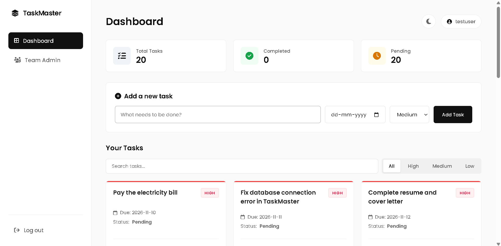
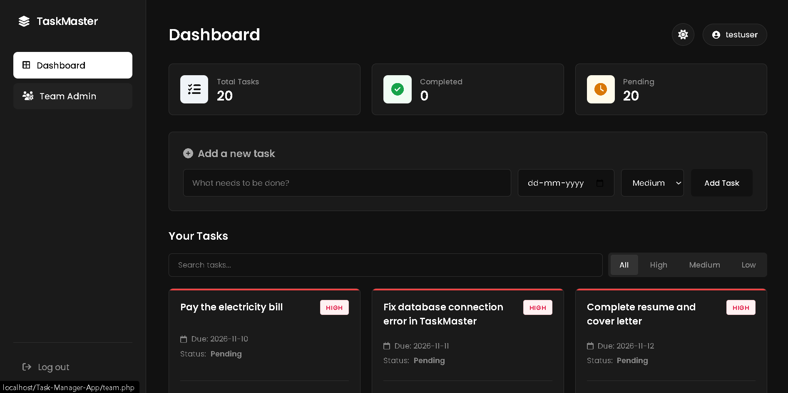
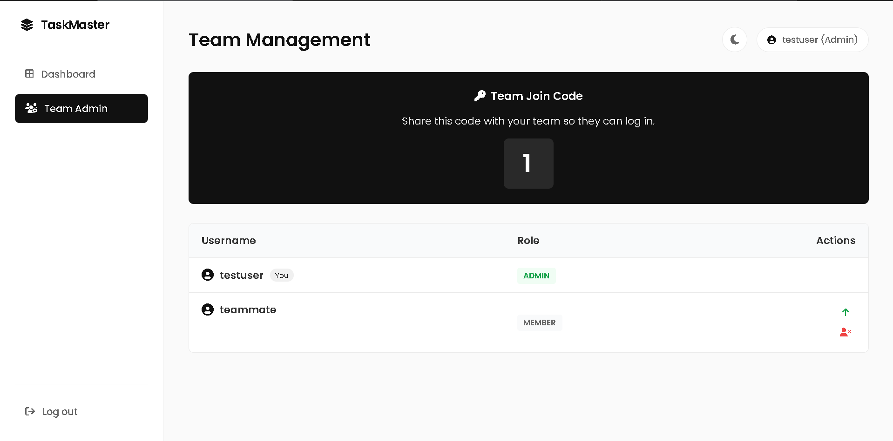
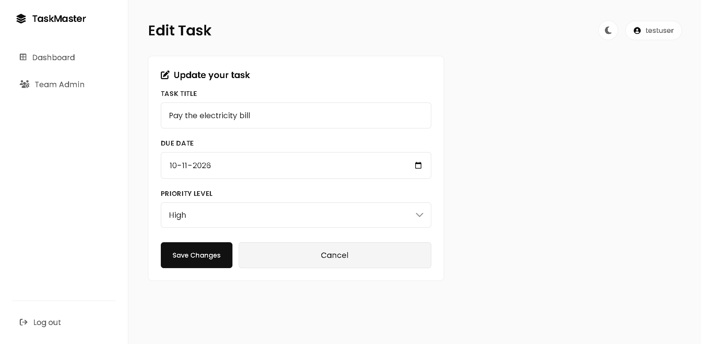
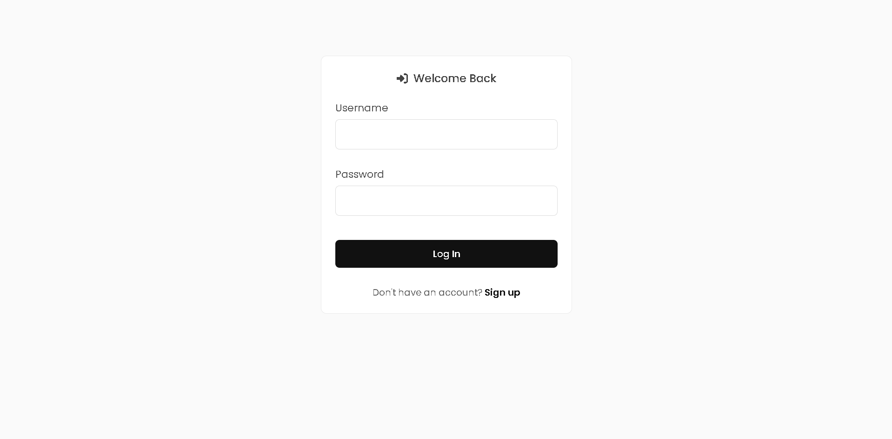
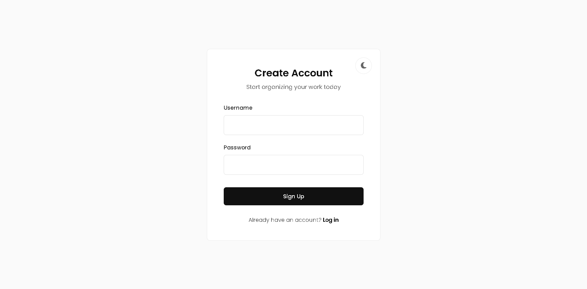

# TaskMaster - Multi-Tenant Task Manager

A modern, full-stack task management web application featuring a multi-tenant architecture. Users can manage tasks in private "Solo" workspaces or collaborate in shared "Team" workspaces using secure join codes.

Built with PHP, MariaDB, and vanilla JavaScript.

## 📸 App Showcase

| Dashboard (Light Mode) | Dashboard (Dark Mode) |
| :---: | :---: |
|  |  |

| Team Admin (RBAC) | Edit Task |
| :---: | :---: |
|  |  |

| Login & Team Join | Register |
| :---: | :---: |
|  |  |

## ✨ Key Features
- **Multi-Tenant Workspaces:** Create a private Solo workspace, or generate a secure code to invite team members to a shared workspace.
- **Role-Based Access Control (RBAC):** Workspace Admins have a dedicated dashboard to promote members to Admins, demote them, or remove them from the team.
- **Authentication:** Secure signup and login (passwords hashed with `password_hash`).
- **CRUD Operations:** Add, edit, delete, and mark tasks as complete.
- **Real-time Filtering:** Instantly search tasks and filter by priority (High, Medium, Low) using JavaScript.
- **Premium Minimalist UI:** A clean, responsive black-and-white design featuring a dark mode toggle and custom interactive modals.

## 🛠️ Tech Stack
- **Backend:** PHP 8
- **Database:** MariaDB (accessed securely using PDO)
- **Frontend:** HTML, CSS, JavaScript
- **Server:** XAMPP (local development)

## 🔒 Security Practices
- **Password Security:** Passwords are hashed with `password_hash()` and verified with `password_verify()`.
- **SQL Injection Protection:** All database queries use PDO Prepared Statements.
- **XSS Protection:** User input is escaped using `htmlspecialchars()` before rendering.
- **Session Security:** Session IDs are regenerated upon login to prevent session fixation/hijacking.
- **Data Isolation:** Database queries strictly enforce `workspace_id` checks, ensuring users can only access data belonging to their active workspace.
- **Environment Variables:** Sensitive database credentials are stored in a `.env` file and kept out of version control via `.gitignore`.

## 🚀 How to Run Locally

1. Install **XAMPP** and start **Apache** and **MySQL** in the XAMPP Control Panel.
2. Clone this repository into your `C:\xampp\htdocs\` folder (or create a junction link).
3. Open `http://localhost/phpmyadmin`, create a database named `task_manager`, and import the provided `database.sql` file.
4. Rename `.env.example` to `.env` (or create a `.env` file) in the root directory and add your database credentials:
   ```env
   DB_HOST=localhost
   DB_PORT=3306
   DB_NAME=task_manager
   DB_USER=root
   DB_PASS=

🧠 Project Summary & Architecture
This project was built to demonstrate a deep understanding of relational databases, secure authentication, and Role-Based Access Control (RBAC).

How the Multi-Tenant Logic Works:
Unlike a standard to-do app where tasks belong to a single user_id, TaskMaster uses a workspace_id architecture.

When a user registers, a new Workspace is automatically created for them, and they are assigned the admin role in the workspace_members table.

Every task is tied to a workspace_id, not just a user.

When a user enters a Team Code at login, they are added to that specific workspace_id as a member.

This means anyone in that workspace can see the tasks, but only users with the admin role can access team.php to manage members.

Database Design (3-Tier Relationship):

users (Stores account credentials)

workspaces (Stores the team/workspace info)

workspace_members (A pivot table linking users to workspaces, storing their role)

tasks (Linked to the workspace so the whole team can see them)

This architecture allows a single user to be an Admin of their own Solo workspace, and a Member of someone else's Team workspace at the same time.

.

📂 Project Structure
File	        Purpose
db.php	        Secure database connection using .env
register.php	User registration and auto-workspace creation
login.php	    Authentication (handles Solo vs. Team login)
index.php	    Main task dashboard (Filtering, Stats, CRUD)
team.php	    Admin dashboard (Member management & Access control)
edit.php	    Edit task interface with custom modals
toggle.php	    Mark task as complete/incomplete
delete.php	    Delete a task
theme.js	    Dark mode toggle logic

📄 License
All rights reserved. This code is for viewing and portfolio purposes only.

