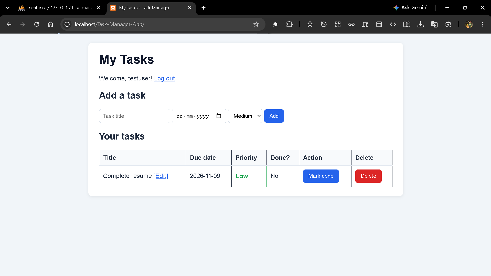

# Task Manager App



A web app where users sign up, log in and manage their own tasks. Built with PHP and MariaDB as a learning project.

## Features
- Sign up and log in (passwords are hashed, never stored as plain text)
- Add tasks with a title, due date and priority (High, Medium, Low)
- Edit and delete tasks
- Mark tasks as done or undo
- Each user can only see and change their own tasks

## Tech Stack
- PHP 8 (backend)
- MariaDB (database), accessed with PDO
- HTML and CSS (pages)
- XAMPP (local server)

## Security Practices
- Passwords hashed with `password_hash` and checked with `password_verify`
- Prepared statements to prevent SQL injection
- Output escaped with `htmlspecialchars` to prevent XSS
- Session ID regenerated after login
- Every edit, delete and update is checked against the logged-in user's ID

## How to Run Locally
1. Install XAMPP and start **Apache** and **MySQL** in the XAMPP Control Panel.
2. Put this project folder inside `C:\xampp\htdocs\`.
3. Open `http://localhost/phpmyadmin`, create a database named `task_manager`, and run this SQL:

```sql
CREATE TABLE users (
    id INT AUTO_INCREMENT PRIMARY KEY,
    username VARCHAR(50) NOT NULL UNIQUE,
    password_hash VARCHAR(255) NOT NULL,
    created_at TIMESTAMP DEFAULT CURRENT_TIMESTAMP
);

CREATE TABLE tasks (
    id INT AUTO_INCREMENT PRIMARY KEY,
    user_id INT NOT NULL,
    title VARCHAR(100) NOT NULL,
    due_date DATE NULL,
    priority ENUM('High','Medium','Low') NOT NULL DEFAULT 'Medium',
    is_done TINYINT(1) NOT NULL DEFAULT 0,
    created_at TIMESTAMP DEFAULT CURRENT_TIMESTAMP,
    FOREIGN KEY (user_id) REFERENCES users(id) ON DELETE CASCADE
);
```

4. Check the database settings in `db.php` (host, port, user, password).
5. Open `http://localhost/Task-Manager-App/register.php` to create an account.

## Project Structure
| File | Purpose |
|------|---------|
| `db.php` | Database connection |
| `register.php` | Sign up |
| `login.php` / `logout.php` | Log in and log out |
| `index.php` | Task list and add task form |
| `edit.php` | Edit a task |
| `toggle.php` | Mark done or undo |
| `delete.php` | Delete a task |

## Planned Improvements
- Better page design (CSS)
- Login protection against repeated wrong passwords
- Search and filter tasks

## License
All rights reserved. This code is for viewing only.